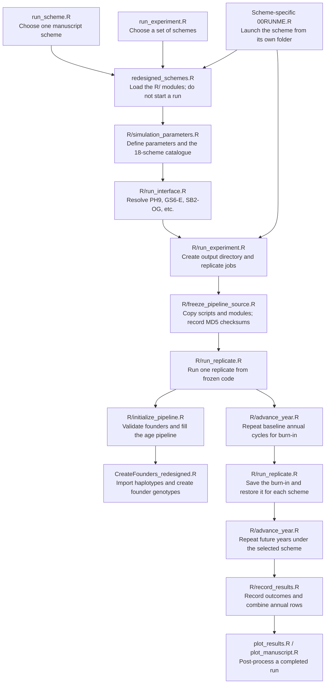
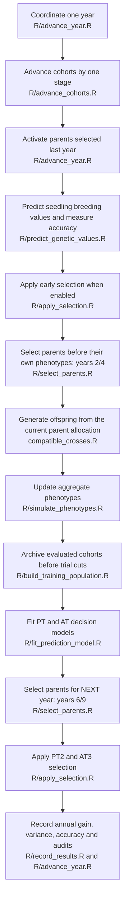
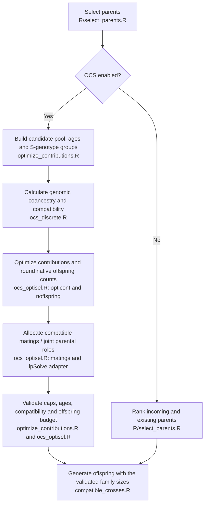

# How the breeding pipeline connects

This guide follows the executable scripts rather than only the biological stages.
Paths are relative to `02_ClonalBreeding/`. **Arrows between modules represent
function calls**: the loader sources their definitions once; the simulator does
not source every module again at each annual step.

## Start an experiment

`R/run_replicate.R` also saves partial records, allocation audits, training
audits, timing logs and scenario status. A scenario failure is recorded without
automatically retrying it. Other scenarios continue under the existing policy.
The experiment controller schedules Pheno/GS workers and then processes pedigree
schemes with the existing ASReml policy. Selecting only GS does not select any
pedigree scheme, although the controller still visits its empty pedigree phase.

## Follow one breeding year

Open [R/advance_year.R](R/advance_year.R) first. Its numbered comments follow
the sequence below. This order preserves which records exist at each decision.

Important timing details:

- Early selection uses the previously available prediction model. Its accuracy
  is calculated before retaining the 500 selected seedlings.
- Year-2/year-4 parental candidates are selected before their own yield records.
- Year-6/year-9 parental decisions use the current year's updated evaluations
  and are stored for crossing in the following year.
- PT/AT training archives are saved before reducing trial populations. The
  training data therefore retain the original PT records, not just survivors.
- Recording remains after early and trial selection. Scientific scenario IDs
  remain unchanged; current OCS outputs report the enabled flag and target Ne.

## Follow the OCS branch

`optimize_contributions.R` constructs the current Ne-based optimization inputs.
The native optiSel workflow and its biological adapters implement the constraints
described in [MANUAL_OCS.md](MANUAL_OCS.md).

## Script responsibilities

| Script | Main responsibility | Main input -> output |
| --- | --- | --- |
| `run_scheme.R` | Launch a selected scheme | CLI options -> experiment |
| `run_experiment.R` | Launch a selected scheme set | CLI options -> experiment |
| `redesigned_schemes.R` | Load modules for new and old entry points | Script directory -> functions |
| `R/run_interface.R` | Resolve manuscript aliases and validate CLI choices | Names/settings -> selected catalogue |
| `R/simulation_parameters.R` | Define shared settings and scheme differences | Parameters -> configuration/catalogue |
| `R/run_experiment.R` | Freeze code and schedule workers | Configuration -> jobs, combined results/status |
| `R/freeze_pipeline_source.R` | Preserve executable code | Checkout -> frozen scripts and checksums |
| `R/run_replicate.R` | Initialize, burn in, and execute paired scenarios | Replicate seed/job -> records and audits |
| `R/initialize_pipeline.R` | Import founders and populate initial stages | Founder bank -> mutable simulation state |
| `R/advance_year.R` | Coordinate the biological annual sequence | State -> updated state and annual record |
| `R/advance_cohorts.R` | Age all cohorts once | Previous stage populations -> next stages |
| `R/simulate_phenotypes.R` | Update correlated aggregate evaluations | Genetic values/environment/history -> phenotypes |
| `R/build_training_population.R` | Archive and choose decision cohorts | Evaluated cohorts -> PT or PT+AT training |
| `R/fit_prediction_model.R` | Fit decision-specific models | Training data -> model/predictions and diagnostics |
| `R/predict_genetic_values.R` | Predict candidate breeding values | Candidates/model -> scored candidates |
| `R/apply_selection.R` | Apply rank-based early and trial selection | Scored population -> retained individuals |
| `R/select_parents.R` | Choose parents or dispatch OCS | Existing/incoming parents -> allocation |
| `optimize_contributions.R` | Translate almond biology to OCS inputs | Candidate pool -> validated OCS allocation |
| `ocs_discrete.R` | Coancestry and compatibility calculations | Genotypes -> K, compatibility, metrics |
| `ocs_optisel.R` | Native optimization, counts and mating assignment | Constraints/BVs/K -> counts and mating plan |
| `compatible_crosses.R` | Generate compatible offspring | Parents/plan -> F1 population |
| `R/record_results.R` | Summarize stages and combine records | Populations/records -> annual data frames |
| `R/runtime_diagnostics.R` | Timing, diagnostics and output checks | Tasks/conditions -> external logs |
| `plot_manuscript.R` | Produce manuscript plots/statistics | Completed run -> figures and analysis files |
| `analysis/export_pedigree.R` | Optional pedigree export | Saved pedigree -> CSV |

Most functions retain their `redesign_*` names so existing launchers still work.
The four `*_PT_original` functions are now explicit definitions of the PT-only
model path. They are not aliases created before a later override. The repeated
PT/AT path calls them when needed; it does not fit a different biological design.
