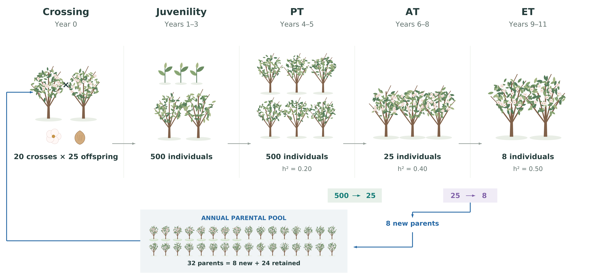
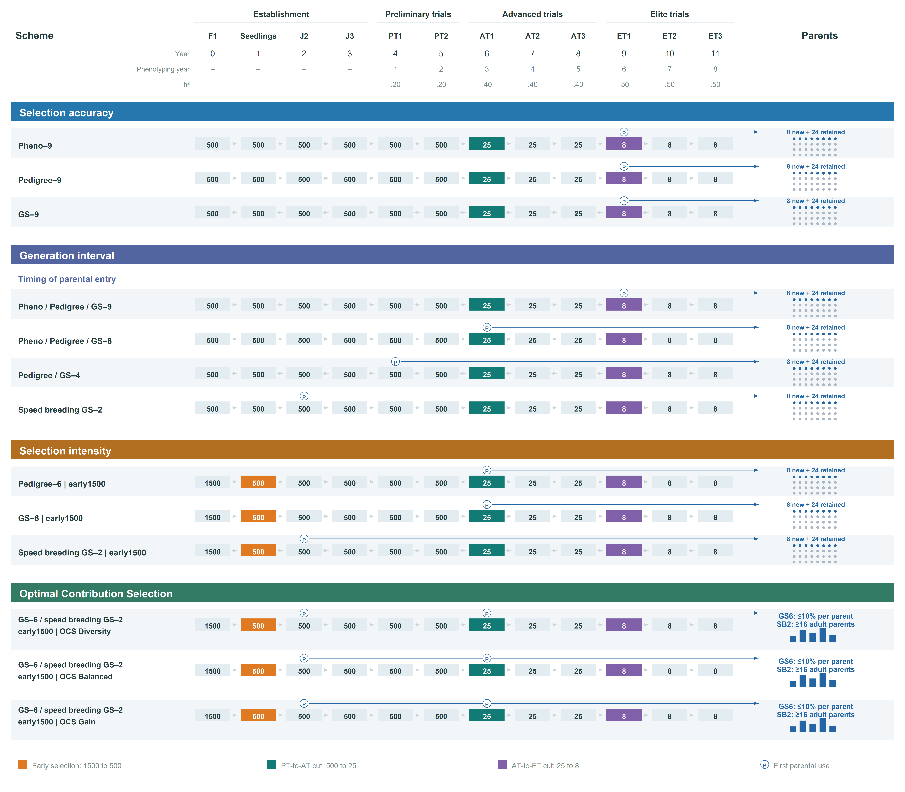
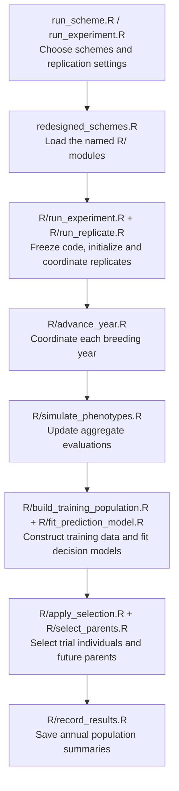

# AlmondSim

**Stochastic simulation of almond breeding programs with AlphaSimR.**

AlmondSim evaluates how selection method, generation interval, selection intensity and optimal contribution selection affect long-term genetic gain, prediction accuracy and genetic diversity in almond breeding. It represents overlapping generations, annual environmental variation, successive field evaluation stages and biological restrictions on crossing.

The clonal breeding framework was adapted from [Bančič et al. (2025)](https://doi.org/10.1002/csc2.21312). The current implementation provides an almond-specific scenario catalogue, decision-specific prediction models and an optiSel-based contribution and mating allocation workflow.

## Breeding framework



*Figure 1. Baseline breeding program. Each annual cycle produces 500 offspring from 20 crosses. Preliminary trials (PT), advanced trials (AT) and elite trials (ET) occur in years 4–5, 6–8 and 9–11, respectively. Selection reduces each cohort from 500 to 25 and then to eight individuals. In the baseline scheme, the annual pool contains eight new and 24 retained parents. The displayed heritabilities are targets for aggregate stage evaluations in the reference population.*

The default experiment comprises 14 initialization cycles, a 40-year burn-in and 40 future years. Scenarios within a replicate share a burn-in population and an annual environmental calendar, supporting paired comparisons. Genetic gain is measured relative to each replicate's own burn-in population.

## Breeding strategies



*Figure 2. Organization of the manuscript comparisons. Scheme numbers denote the year of first parental use. Early selection reduces 1,500 seedlings to 500. In speed breeding, pollen can be used from year 2, while maternal use starts in year 4. The OCS panel illustrates variable contributions, a maximum contribution of 10% per parent in GS–6 and at least 16 contributing adult parents in speed breeding GS–2.*

| Comparison | Strategies |
| --- | --- |
| Selection accuracy | Phenotypic selection, pedigree BLUP and genomic selection with first parental use in year 9 |
| Generation interval | First parental use in years 9, 6, 4 or 2, where supported by the selection method |
| Selection intensity | Standard cohorts of 500 versus early selection of 500 from 1,500 seedlings |
| Optimal contribution selection | GS–6 and speed breeding GS–2 with Diversity, Balanced and Gain profiles |

The repository contains the **18 breeding schemes** evaluated in the manuscript. The full list, identifiers and prediction rules are in [SCHEMES.md](02_ClonalBreeding/SCHEMES.md).

## Reading and reviewing the code

Start with the [script connection diagrams](02_ClonalBreeding/PIPELINE.md) and
[review guide](02_ClonalBreeding/REVIEW_GUIDE.md). The diagrams name each script
and explain its task, from launching a scheme through the annual selection and
crossing cycle to recording results. The central annual coordinator is
[`R/advance_year.R`](02_ClonalBreeding/R/advance_year.R); the surrounding modules
separate phenotyping, training, prediction, selection, parent allocation and
execution. Use `run_scheme.R` for one scheme and `run_experiment.R` for a set
of schemes. Scheme-specific `00RUNME.R` launchers use the same engine loader,
`redesigned_schemes.R`.

The annual script shows population replacements explicitly, for example
`ET3 <- previous ET2`, seedling retention after early selection, and the PT/AT
trial cuts. Its ten numbered steps follow the breeding year. Technical output
columns are kept in `R/record_results.R`, so they do not obscure the biological
sequence. Prediction fitting and OCS remain in dedicated calculation modules.



This overview shows script responsibilities. The detailed pipeline guide also
shows crossing, early selection and the different parental-decision timings.

To inspect the new launchers without starting simulations:

```sh
Rscript 02_ClonalBreeding/run_scheme.R --help
Rscript 02_ClonalBreeding/run_scheme.R --list
```

After configuring the external input/output paths below, a single scheme or a
selected experiment can be started explicitly:

```sh
Rscript 02_ClonalBreeding/run_scheme.R --scheme=GS6-E --replicates=1 --workers=1 --threads=6
Rscript 02_ClonalBreeding/run_experiment.R --schemes=GS6-E,SB2-E --replicates=10 --workers=4 --threads=6
```

These commands create new experiments; they do not resume existing runs.

### Prediction models

- **Phenotypic selection** ranks candidates using their available aggregate phenotypes.
- **Pedigree prediction** uses additive BLUP in ASReml-R, with pedigree relationships and record year as a fixed effect.
- **Genomic prediction** uses SNP-based ridge-regression BLUP in AlphaSimR, accounting for record year.

Training populations follow the decision being made. PT selection uses the current completed PT cohort and its two predecessors. AT selection uses the original PT records of the current completed AT cohort and its two predecessors, retaining candidates' own records. Each training window contains 1,500 individuals.

For GS–9 and Pedigree–9, AT selection and parental recruitment additionally use 75 AT observations from the same individuals: **1,575 observations on 1,500 individuals**. PT and AT records retain their own observation years and share an individual genetic effect. Both methods use the same calibrated relative error covariance structure; its scale is estimated within each fit. GS uses `AlphaSimR::solveRRBLUP` after whitening, and pedigree prediction uses ASReml-R. Other genomic models use `AlphaSimR::RRBLUP`.

Genotype-by-year responses are simulated. Prediction models account for record year as a fixed effect; they do not fit a separate genotype-by-year interaction. Older retained parents' own records are not appended beyond the defined training window. See [SCHEMES.md](02_ClonalBreeding/SCHEMES.md) for the full assumptions.

### Optimal contribution selection

The current workflow optimizes **one contribution per genotype** with native
`optiSel::opticont` (`max.BV`, package-default solver), then uses native
`noffspring` integer allocation. `matings` handles fixed maternal/paternal groups;
when adult speed-breeding candidates share both roles, a directed integer
`lpSolve` adapter jointly assigns roles and compatible pairs while preserving
the native total counts. Contributions are not repaired or refined after optimization.

Diversity, Balanced and Gain use **Ne-based control parameters 30, 10 and 5**.
`ocs_enabled` activates OCS and `ocs_target_Ne` specifies the profile's target.
The annual coancestry bound uses standing-parent mean genomic coancestry and
mean age as a generation-interval proxy. These control parameters are not
estimates or guarantees of realized effective population size.

OCS produces **1,500 offspring**, followed by early selection of 500. GS–6
retains a **10% combined contribution cap per genotype**. In speed breeding,
adults (age at least 4) have a **3.2% cap**, and younger pollen donors have a
**10% cap**. Pollen-only candidates jointly contribute at most 50%; the adult
cap therefore guarantees **at least 16 contributing adults**, also checked after
rounding and mating. There is no fixed maximum number of contributing parents.

Mutually incompatible self-incompatible S-genotype groups have a combined
contribution limit of 50%. Sharing only one S allele permits crossing.
Mothers must be at least
4 years old; pollen donors must be at least 2 in speed breeding and 4 otherwise.
Compatibility, no selfing, individual caps and offspring totals remain hard constraints.

Continuous and rounded coancestry excesses up to 10% relative to the bound,
plus a numerical tolerance of 1e-7, are audited and permitted; larger departures
fail explicitly. Failed attempts are recorded without automatic retry.

## Requirements

The validated development environment uses R 4.4.1, AlphaSimR 2.1.0 and optiSel 2.1.0. Pedigree schemes require **ASReml-R 4.2 and an available licence**. ASReml-R is installed separately from its licensed distribution.

Install the public R dependencies:

```r
install.packages(c(
  "AlphaSimR", "optiSel", "lpSolve", "jsonlite", "data.table", "ggplot2"
))
```

Founder generation is a separate preprocessing step. The simulator imports a prepared almond haplotype bank; large founder inputs and generated simulation data are not included in this repository.

### Founder inputs and output storage

Set these paths before launching an experiment:

| Variable | Purpose |
| --- | --- |
| `ALMONDSIM_FOUNDER_BANK` | Prepared founder-bank directory, or its parent containing bank runs |
| `ALMONDSIM_DATA_DIR` | External directory for experiment snapshots, logs, results and plots |

The founder bank must match the expected format: a completed manifest, 150 diploid individuals, eight chromosomes, mutation rate `1e-8`, and chromosome-specific position and genotype files (`Chr_1_position.txt`, `Chr_1_gmatrix.txt`, through chromosome 8).

**Outputs must remain outside the source repository.** See [STORAGE.md](02_ClonalBreeding/STORAGE.md) for storage conventions and execution details.

## Running an experiment

Run the following from the repository root after installing the dependencies and preparing founder inputs. Calling `coordinate_breeding_experiment()` starts a new experiment; sourcing the engine only defines its functions.

```r
Sys.setenv(
  ALMONDSIM_FOUNDER_BANK = "/path/to/prepared/founder_bank",
  ALMONDSIM_DATA_DIR = "/path/to/external/almondsim_data"
)

root <- normalizePath("02_ClonalBreeding", winslash = "/")
source(file.path(root, "redesigned_schemes.R"))

config <- breeding_config()
config$reps <- 10L
config$workers <- 4L
config$threads <- 6L

scenarios <- all_breeding_scenarios(root)


run <- coordinate_breeding_experiment(root, config, scenarios)

source(file.path(root, "plot_results.R"))
plot_experiment(run$run_dir)
```

Use `run_experiment.R --schemes=all` to launch the full catalogue. Each numbered
scenario folder also contains an individual `00RUNME.R` entry point.

Phenotypic and genomic schemes run in parallel. Pedigree schemes are processed afterwards in a sequential ASReml worker. Worker and thread counts should be adjusted to available resources and licence constraints.

## Results and reproducibility

Each experiment stores its configuration, source snapshot, progress information, scenario status, diagnostics, annual results and plots in its external run directory. Prediction and OCS audits support checks of training populations, solver diagnostics, contributions and biological constraints.

A failed scenario is recorded separately while other scenarios continue. Coverage must be checked before reporting a comparison. At ten replicates and 40 future years, complete coverage corresponds to:

- **7,200 annual rows** for all 18 schemes (18 x 10 x 40).

Report the actual number of complete paired replicates, preserve failed-run diagnostics and distinguish simulation uncertainty from missing coverage. Selection accuracy is evaluated against simulated genetic values for assessment, not supplied as a response to prediction models.

## Manuscript figures

The plotting workflow produces four main horizontal triptychs (selection method,
generation interval, selection intensity and OCS) and a vertical final-year
boxplot grid containing all 18 schemes. Method-family colours are consistent across trajectory panels;
endpoint colours identify the four Methods blocks.

See [PLOTTING.md](02_ClonalBreeding/PLOTTING.md) for scheme abbreviations,
paired-replicate rules, provisional previews and 400 dpi PNG/vector PDF export.

## Repository layout

```text
almondsim/
├── README.md
├── LICENSE
├── docs/figures/                 # Breeding-program diagrams
└── 02_ClonalBreeding/
    ├── run_scheme.R             # Select one scheme
    ├── run_experiment.R         # Select a set or all schemes
    ├── 00_Burn_in/              # Founder and trait settings
    ├── 01_Pheno_Y9/ ...         # Numbered scenario settings and launchers
    ├── redesigned_schemes.R     # Load the R/ modules
    ├── R/                      # Annual cycle, models, selection and execution
    ├── ocs_*.R                 # Contribution and mating allocation backend
    ├── plot_results.R          # Plotting utilities
    ├── tests/                  # Focused implementation checks
    ├── analysis/               # Optional pedigree export
    ├── PIPELINE.md             # Script connection diagrams
    ├── REVIEW_GUIDE.md         # Where to review each decision
    ├── MANUAL_OCS.md           # Current OCS workflow and settings
    ├── SCHEMES.md              # Scenario definitions and model assumptions
    └── STORAGE.md              # Inputs, external storage and execution
```

## References and attribution

Please cite the methods and software used in your analysis:

- Bančič et al. (2025). *Plant breeding simulations with AlphaSimR*. Crop Science, 65, e21312. [doi:10.1002/csc2.21312](https://doi.org/10.1002/csc2.21312).
- Gaynor, Gorjanc and Hickey (2021). *AlphaSimR: an R package for breeding program simulations*. G3, 11, jkaa017. [doi:10.1093/g3journal/jkaa017](https://doi.org/10.1093/g3journal/jkaa017).
- Wellmann (2019). *optiSel: optimum contribution selection and population genetics*. BMC Bioinformatics, 20, 25. [doi:10.1186/s12859-018-2450-5](https://doi.org/10.1186/s12859-018-2450-5).
- Adrion et al. (2020). *A community-maintained standard library of population genetic models*. eLife, 9, e54967. [doi:10.7554/eLife.54967](https://doi.org/10.7554/eLife.54967). Relevant to founder generation using stdpopsim.

## Licence

The source code is distributed under the [MIT licence](LICENSE). Original framework authorship and copyright notices are retained.
